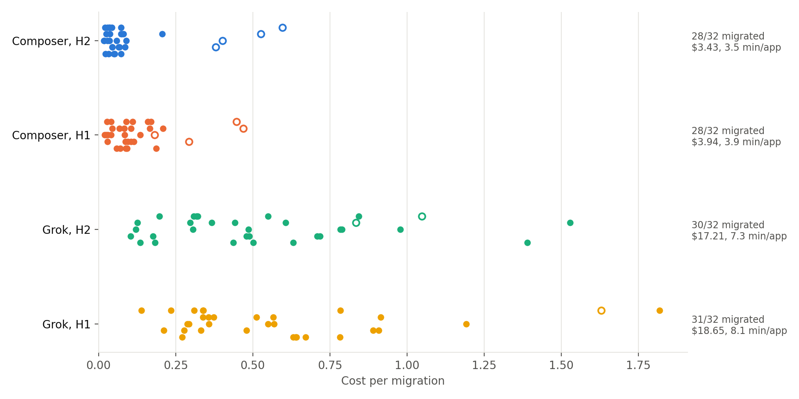

# Cloud Agents for Payment Security: Migrating Mastercard reference apps from Java 8 to 17

<p align="center">
  
</p>

Mastercard's client-library policy says Java 17 and above. Of its 56 public Java repositories, 32 still build on Java 7, 8 or 11. This harness forks each one, hands it to a Cursor cloud agent with a pinned set of instructions and tools, and grades the branch the agent pushes with five checks.

## How a run works

```
pinned commit ──► private fork + harness files ──► cloud agent migrates and pushes a branch
                                                              │
                 grader: five checks, outside the VM ◄────────┘
                   │ fail + --retry: failed checks go back to the same agent, once
                   │ pass + --pr: pull request with the verdict and the cost
                   ▼
                 usage ledger ──► cost
```

Two setups:

| | The agent gets | Versions come from |
| --- | --- | --- |
| H1, minimal harness | The repo, `AGENTS.md`, a migration skill, and a `lookup_dependency` MCP tool | The agent asks the tool |
| H2, static rewrite plus agent | The same, but `tools/bump_poms.py` has already raised every pinned version in `pom.xml`; no tool | The script, before the agent starts |

The version table is `grader/dependency_version.json`, MigrationBench's list of current majors for 240 Maven artifacts. In a company this is the platform team's approved-versions list.

## The grader

`grader/grade.py` reimplements the five checks of [MigrationBench](https://github.com/amazon-science/MigrationBench)'s "maximal migration" (Amazon Science, KDD 2026). It clones the repo at the base commit, applies the agent's diff, and runs:

- r1: `mvn clean verify` passes on Java 17.
- r2: every compiled main class has major version 61.
- r3: the test files, their classes and their methods are the same set as at the base commit.
- r4: at least as many tests run as ran at the base commit.
- r5: every dependency declared in a pom and present in the version table is at or above that major.

A migration passes when all five hold. The r4 baseline is measured once by running the base commit's tests on Java 8, then cached; 15 of the 32 apps cannot run their tests at the base commit, so r4 is marked `s` for them and r1 and r3 still apply. The output names the failing dependencies, the test-set changes and the Maven errors, and the retry prompt is built from it. Where we compared it, the verdict matched the stock MigrationBench `run_eval`.

## What we found

All 32 apps, each setup once with each model, one retry allowed, 8 Nov 2026. Dollars are what the usage ledger charged, including any retry.

| Model | Setup | Migrated | Total | Per app | Minutes per app | Calls per app |
| --- | --- | --- | --- | --- | --- | --- |
| Composer 2.5 | H2 | 28/32 | $3.43 | $0.11 | 3.5 | 43 |
| Composer 2.5 | H1 | 28/32 | $3.94 | $0.12 | 3.9 | 68 |
| Grok 4.7 | H2 | 30/32 | $17.21 | $0.54 | 7.3 | 64 |
| Grok 4.7 | H1 | 31/32 | $18.65 | $0.58 | 8.1 | 94 |

- **28 apps migrate in every cell for about a dime each.** That includes all 7 Java 7 and all 6 Java 11 apps.
- **The 4 that differ already fail their tests at the base commit.** Composer got none of them; Grok got two on H2 and three on H1, at $0.84 to $1.82 each.
- **The static rewrite cuts cost and review load.** On Composer it is a third fewer tool calls and 13 percent less money for the same 28, and issuing becomes a four-line `pom.xml` change instead of eight files.
- **The expensive model buys two or three apps for five times the bill.** About $7 per extra app.
- **The retry pays for itself.** On Composer H2 it fired 11 times and fixed 7 for $1.13 of the $3.43, usually one dependency below its major, fixed in a minute for a few cents.

## Repo layout

```
src/        The harness: fork, agent, grader, ledger, report.
grader/     grade.py, dependency_version.json, requirements.txt.
harness/    Copied into every fork: AGENTS.md, .cursor/ (JDK bootstrap, hooks, skill, MCP), tools/.
repos/      fleet.csv: the 32 apps with their pinned commits.
results/    summary.csv per cell, and the figure.
scripts/    setup.sh, summarize.py (tables), figures.py (the figure).
test/       Unit tests.
```

## Set up

Node 22+, Python 3.10+, git, a Cursor account with cloud agents, and a GitHub user that can create private repos.

```bash
bash scripts/setup.sh   # npm install, the grader's venv, Temurin 17 + Zulu 8 + Maven 3.9.6 under ~/opt, toolchain paths into .env
```

Then put `CURSOR_API_KEY`, `CURSOR_ADMIN_API_KEY`, `GITHUB_TOKEN` and `FORK_OWNER` in `.env`, install the Cursor GitHub app on that account, and run `npm test`. `PREFIX=/other/dir bash scripts/setup.sh` installs the toolchain elsewhere.

## Usage guide

```
npm run harness -- --setup h1|h2 (--repo <url> [--base <sha>] | --repos <csv>) [options]
```

| Flag | Meaning | Default |
| --- | --- | --- |
| `--setup h1\|h2` | H1: agent plus lookup tool. H2: pom rewrite first, then the agent. | required |
| `--repo <url>` | One GitHub repository. | |
| `--base <sha>` | Commit to migrate from, with `--repo`. | the repo's HEAD |
| `--repos <csv>` | A batch: `repo,github_url,base_commit` rows. | |
| `--only <text>` | With `--repos`, only rows whose name or URL contains this. | all rows |
| `--retry` | On a failed grade, send the failed checks back to the same agent once. | off |
| `--pr` | When the migration passes, open a pull request on the fork with the grader's verdict and cost in the body. | off |
| `--model <id>` | Any id from `Cursor.models.list()`. Fast mode is turned off when the model has it. | `composer-2.5` |
| `--target 17\|21` | Java release to land on; sets the class-major check. | `17` |
| `--concurrency <n>` | Agents in flight, 1 to 5. | `1` |
| `--budget <n>` | Tool calls per agent before the run is cancelled. | `200` |
| `--name <text>` | Run name; output goes to `out/<name>/`. | repo name or setup, model, time |
| `--out <dir>` | Output root. | `out` |

Environment, in `.env`: `CURSOR_API_KEY` (drives agents), `CURSOR_ADMIN_API_KEY` (reads the usage ledger), `GITHUB_TOKEN` and `FORK_OWNER` (private forks), `JAVA17_HOME`, `JAVA8_HOME`, `MAVEN_HOME` (grader toolchain). See `.env.example`.

### Any Maven repo on GitHub

```bash
npm run harness -- --setup h2 --repo https://github.com/org/my-service --retry
```

The harness pins the repo's HEAD, creates or reuses a private fork under `FORK_OWNER`, pushes the harness files as `harness/my-service-h2`, runs one agent that pushes `migrate/my-service-h2`, measures the base commit's test count, grades the branch, retries once if needed, and writes `out/my-service-h2/summary.csv`. To grade against your own approved-versions list, replace `grader/dependency_version.json`; both the pom rewrite and r5 follow it.

### Reproduce the runs

```bash
# Plumbing check on one app before spending on 32.
npm run harness -- --setup h2 --repos repos/fleet.csv --only location-intelligence --retry --name proof

# All 32 apps: two setups, two models.
npm run harness -- --setup h2 --repos repos/fleet.csv --concurrency 5 --retry --name fleet-composer-h2
npm run harness -- --setup h1 --repos repos/fleet.csv --concurrency 5 --retry --name fleet-composer-h1
npm run harness -- --setup h2 --repos repos/fleet.csv --concurrency 5 --retry --model grok-4.7 --name fleet-grok-h2
npm run harness -- --setup h1 --repos repos/fleet.csv --concurrency 5 --retry --model grok-4.7 --name fleet-grok-h1

# Live demo: one repo. Pass one misses r5 on two pinned test libraries; the retry fixes it; a PR opens.
npm run harness -- --setup h2 --repo https://github.com/Mastercard/issuing-api-reference-app --retry --pr

# Tables and the figure.
python3 scripts/summarize.py out/fleet-*/summary.csv
python3 scripts/figures.py out/fleet-*/summary.csv --labels "Composer, H2" "Composer, H1" "Grok, H2" "Grok, H1" -o fleet.png
```

Each run writes `out/<name>/summary.csv` and, per repo, `report.json`, `run.ndjson` (every agent event), `source.diff` (what was graded) and `grader.log`. Ledger events can land a minute late; `npm run costs -- out/<name>` re-reads them.
