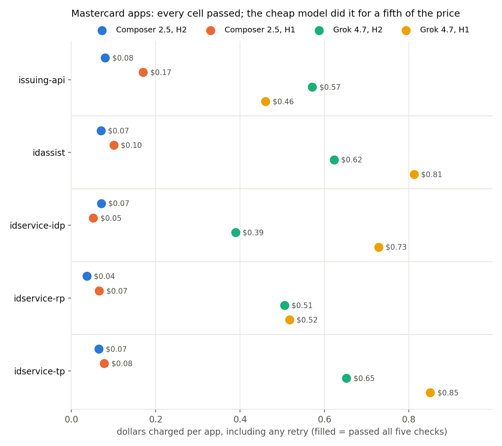

# Java 8 to 17 for Mastercard's reference apps, with Cursor cloud agents

<p align="center">
  
</p>

<p align="center"><em>Two ways to use a cloud agent, two models, every Mastercard reference app that is not yet on Java 17. Pass or fail comes from an independent grader; dollars come from the usage ledger.</em></p>

Mastercard's client-library policy says Java 17 and above. Of its 56 public Java repositories, 32 still build on Java 7, 8 or 11. This harness forks such an app, hands it to a Cursor cloud agent with a pinned set of instructions and tools, grades the branch the agent pushes with five checks on a machine the agent never touches, and writes one row per run: repo, setup, model, the five checks, tool calls, minutes, and the cents the usage ledger charged.

## What we found

RESULTS_PLACEHOLDER

## How a run works

```
repos/<set>.csv ──► fork at base commit ──► + harness files ──► push harness/<run>
                                                                      │
                 ┌──────────────── Cursor cloud agent (one VM per app) ◄──┘
                 │  installs Temurin 8/17 + Maven, migrates, pushes migrate/<run>
                 ▼
         git diff base..branch (harness files and target/ excluded)
                 │
                 ▼
     grader/grade.py on this machine (Java 17)  ──► r1 … r5, pass or fail
                 │                                    │ fail and --retry: the failed
                 │                                    │ checks go back to the same agent once
                 ▼
     usage ledger (admin API, by cloudAgentId) ──► cents  ──► out/<run>/summary.csv
```

Two setups:

| | What the agent gets | Where the versions come from |
| --- | --- | --- |
| `h1`, minimal harness | The repo, `AGENTS.md`, a migration skill, and a `lookup_dependency` MCP tool | The agent asks the tool for each coordinate |
| `h2`, static rewrite plus agent | The same, but `tools/bump_poms.py` has already raised every pinned version in `pom.xml`; no tool | The script, before the agent starts |

`--retry` is the one lever on top: when the grader fails a run, the same agent gets the failed checks, in words, and one more turn.

The version table is `grader/dependency_version.json`, MigrationBench's reference list of current majors for 240 Maven artifacts. In a company this would be the platform team's approved-versions list. Both setups see the same table.

## The grader

`grader/grade.py` reimplements the five checks of MigrationBench's "maximal migration" (Amazon Science, KDD 2026). It clones the upstream repo at the base commit, applies the agent's diff, and runs:

- r1: `mvn clean verify` passes on Java 17.
- r2: every compiled main class has major version 61.
- r3: the test files, their classes and their methods are the same set as at the base commit (parsed with javalang, so formatting and signatures do not matter; an added helper file under `src/test` or a renamed method does).
- r4: at least as many tests run as ran at the base commit. The baseline comes from the repo manifest's `tests` column when present (the five apps use MigrationBench's recorded counts) and is otherwise measured once by running `mvn test` at the base commit on Java 8, then cached.
- r5: every dependency declared in a pom and present in the version table is at or above that major, read from `mvn dependency:tree`.

A run passes when all five hold. The output is one JSON object with each check, the failing dependencies, the test-set changes, and the Maven error lines, which is what the retry prompt is built from. On the runs we checked, the verdict matched the stock MigrationBench `run_eval` on both the maximal and minimal rule.

## Repo layout

```
src/            The harness. main.ts runs repos through fork, agent, grader, ledger.
grader/         grade.py (the five checks), dependency_version.json, requirements.txt.
harness/        Files copied into every fork: AGENTS.md, .cursor/ (bootstrap, hooks, skill, MCP), tools/.
repos/          mastercard.csv (the five identity and issuing apps), fleet.csv (all 32), proof.csv.
results/        summary.csv per reported run, and the figure.
scripts/        summarize.py prints tables; figures.py draws the figure.
test/           Unit tests for the TypeScript and the Python copied into forks.
```

Inside a fork the agent sees `.cursor/bootstrap-jdks.sh` (installs the JDKs), `.cursor/hooks/guard.py` (blocks skipped or deleted tests and version downgrades), `.cursor/skills/java17-migration/SKILL.md`, `.cursor/mcp.json` (h1 only), and `tools/`. The grader excludes all of them, and `target/`, from the diff.

## Set up

You need Node 22+, Python 3.10+, git, a Cursor account with cloud agents enabled, and a GitHub user that can create private repos.

```bash
npm install
python3 -m venv .venv && .venv/bin/pip install -r grader/requirements.txt

# Grader toolchain: Temurin 17 and Maven 3.9.6, plus a JDK 8 for r4 baselines.
# macOS arm64 shown; on Linux the agent's own .cursor/bootstrap-jdks.sh installs the same under /opt.
mkdir -p ~/opt/java && cd ~/opt
curl -fsSLo jdk17.tgz "https://github.com/adoptium/temurin17-binaries/releases/download/jdk-17.0.13%2B11/OpenJDK17U-jdk_aarch64_mac_hotspot_17.0.13_11.tar.gz"
curl -fsSLo jdk8.tgz  "https://cdn.azul.com/zulu/bin/zulu8.82.0.21-ca-jdk8.0.432-macosx_aarch64.tar.gz"
curl -fsSLo maven.tgz "https://archive.apache.org/dist/maven/maven-3/3.9.6/binaries/apache-maven-3.9.6-bin.tar.gz"
mkdir j17 j8 && tar -xzf jdk17.tgz -C j17 --strip-components=1 && tar -xzf jdk8.tgz -C j8 --strip-components=1
mv j17/Contents/Home java/temurin-17 && mv j8/zulu-8.jdk/Contents/Home java/jdk-8 && rm -rf j17 j8 *.tgz
tar -xzf maven.tgz && ln -sfn apache-maven-3.9.6 maven
```

Copy `.env.example` to `.env` and fill it in. `CURSOR_API_KEY` drives the agents. `CURSOR_ADMIN_API_KEY` is only read for the usage ledger, which is where cost comes from. Install the Cursor GitHub app on the account named in `FORK_OWNER`. Then:

```bash
npm test
```

## Reproduce the runs

Each command writes `out/<name>/summary.csv` plus a folder per repo with `report.json`, `run.ndjson` (every agent event), `source.diff` (what was graded), and `grader.log`. Nothing under `out/` is committed; copy a summary into `results/` when it is one you want to keep.

```bash
# 1. Plumbing check on a sixth Mastercard app of the same template, not one of the five.
npm run harness -- --setup h2 --repos repos/proof.csv --retry --name proof

# 2. The five apps (idp, rp, idassist, issuing, tp): both setups, cheap model then expensive model.
npm run harness -- --setup h2 --repos repos/mastercard.csv --concurrency 5 --retry --name mastercard-composer-h2
npm run harness -- --setup h1 --repos repos/mastercard.csv --concurrency 5 --retry --name mastercard-composer-h1
npm run harness -- --setup h2 --repos repos/mastercard.csv --concurrency 5 --retry --model grok-4.7 --name mastercard-grok-h2
npm run harness -- --setup h1 --repos repos/mastercard.csv --concurrency 5 --retry --model grok-4.7 --name mastercard-grok-h1

# 3. The whole estate: every Mastercard reference app not yet on Java 17, same four cells.
npm run harness -- --setup h2 --repos repos/fleet.csv --concurrency 5 --retry --name fleet-composer-h2
npm run harness -- --setup h1 --repos repos/fleet.csv --concurrency 5 --retry --name fleet-composer-h1
npm run harness -- --setup h2 --repos repos/fleet.csv --concurrency 5 --retry --model grok-4.7 --name fleet-grok-h2
npm run harness -- --setup h1 --repos repos/fleet.csv --concurrency 5 --retry --model grok-4.7 --name fleet-grok-h1

# 4. The live demo: issuing alone. Pass one misses r5 on two pinned test libraries, the retry fixes it.
npm run harness -- --setup h2 --repos repos/mastercard.csv --only issuing --retry --name demo-issuing

# Tables and the figure from any set of summaries.
python3 scripts/summarize.py out/*/summary.csv
python3 scripts/figures.py results/fleet-*.csv --labels "Composer, H2" "Composer, H1" "Grok, H2" "Grok, H1" -o results/figures/fleet.png
```

Ledger events can land a minute after a run ends. `npm run costs -- out/<name>` re-reads the ledger for every report in a run and rewrites the cost columns; run it once a batch is done. Two processes must not run the same repo under the same run name at once; different run names are fine, since each pushes its own `harness/<run>` branch.

## Run it on any Maven repo on GitHub

The harness does not know anything about Mastercard. It needs a GitHub URL, a commit to migrate from, and a Maven build. Make a CSV:

```csv
repo,github_url,base_commit
my-service,https://github.com/org/my-service,<40-char sha>
```

Then:

```bash
npm run harness -- --setup h2 --repos my.csv --retry --name my-service
```

What happens: a private fork `FORK_OWNER/my-service` is created or reused; the harness files are pushed as `harness/my-service`; an agent migrates and pushes `migrate/my-service`; the grader measures the base commit's test count on Java 8, grades the branch, and sends one retry if needed; `out/my-service/summary.csv` gets one row. Add a `tests` column to the CSV if you already know the baseline count and want to skip the measurement.

Options that matter for a new repo:

- `--setup h1` if you would rather the agent change versions itself through the lookup tool than have the pom rewritten first.
- `--model <id>` for any id from `Cursor.models.list()`; fast mode is turned off when the model has that switch.
- `--target 21` to land on Java 21 instead (changes the compiler target the agent is told and the class-major check).
- `--budget` caps tool calls per agent (default 200) and `--concurrency` caps agents in flight (max 5). Many rows in one CSV run as a batch.
- The version table is `grader/dependency_version.json`. Replace it with your own approved-versions list and both the pom rewrite and r5 follow it.

Limits of that generality: multi-module builds are graded as a whole (`mvn clean verify` at the root); repos that need credentials, Docker, or a running database to pass tests will fail r1 for reasons the agent cannot fix; and r4 needs the base commit to build and test on Java 8 or 17, otherwise it is skipped and the report says so.

## Where the numbers come from

- Pass or fail is `grader/grade.py` on this machine's Java 17, never in the agent VM.
- Cents are the sum of `chargedCents` over the team usage ledger's events for the agent's `cloudAgentId`, bounded by the attempt's own time window. `total_cents` is the undiscounted token price. `agent.getUsage()` is not used: it reports zero for plan-included usage.
- Calls are distinct tool calls seen on the run stream. Minutes are the run's wall clock, including the JDK install at the start.
- Retry cents are the ledger events from the retry's start time onward; `first_charged_cents` and `retry_charged_cents` split them.
- Branches: the prompt names the branch (`migrate/<run>`) and tells the agent to create it first and push it last. Cloud agents do not commit or push on the agent's behalf, so when the branch is missing after a run the harness sends one more message asking for the commit and push; `nudged` in the summary marks those runs.

## Limits

- The agent VM starts without Java. The Environments API is blocked under this account's privacy setting, so every agent spends its first minute installing Temurin 8, Temurin 17, and Maven 3.9.6 from `.cursor/bootstrap-jdks.sh`. A team environment built from that script would remove the minute.
- Five apps separate a cheap setup from an expensive one and show what the retry adds. They do not rank the two setups in general; the 32-app fleet is a better basis, and still one company's template.
- Hooks run on tool calls after the agent's first read-only turns; a downgrade typed in the very first edit is caught by the grader, not the hook.
- An earlier 12-app check on public Spring Boot apps (in this repo's history) tied the two setups at 11 of 12 and cost under $3.50 each; it is not part of the reported results.
