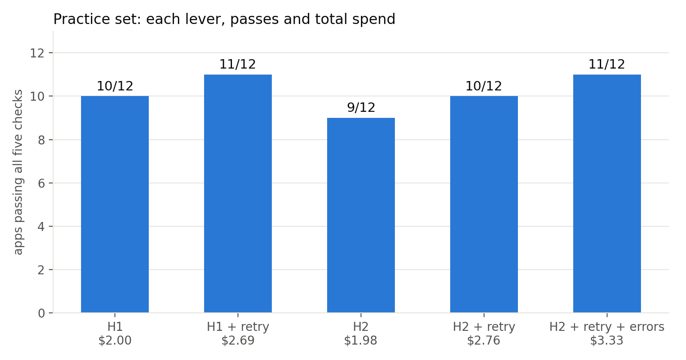

# Java 8 to 17 for Mastercard's reference apps, with Cursor cloud agents

<p align="center">
  
</p>

<p align="center"><em>The setup is chosen on 12 small open-source Spring Boot apps, then run unchanged on Mastercard's apps with a cheap model and an expensive one.</em></p>

Mastercard's client-library policy says Java 17 and above. Of its 56 public Java repos, 26 still build on Java 7 or 8. This harness forks such an app, hands it to a Cursor cloud agent with a pinned set of instructions and tools, and grades the branch the agent pushes with MigrationBench's five checks on a machine the agent never touches. Every run writes one row: repo, setup, model, the five checks, tool calls, minutes, and the cents the usage ledger charged.

## What we found

All numbers below are from `results/*.csv`, produced on 8 Nov 2026 with Composer 2.5 and Grok 4.7 (fast mode off, other parameters at their defaults; the ledger bills Grok as `grok-4.7-high`). Dollars are what the usage ledger charged.

Practice set, 12 small Java 8 Spring Boot apps, Composer 2.5:

| Step | Passed | Spend so far | Agent minutes per app |
| --- | --- | --- | --- |
| H1: agent migrates, lookup tool | 10/12 | $2.00 | 3.6 |
| H1, then one retry on the misses | 11/12 | $2.69 | 5.9 |
| H2: script bumps the pom, agent repairs | 9/12 | $1.98 | 4.1 |
| H2, then one retry on the misses | 10/12 | $2.76 | 5.3 |
| H2, retry, then Maven errors in the prompt for the rest | 11/12 | $3.33 | |

On twelve apps the two setups tie. Each lever bought about one more app for about 70 cents. The retry is cheap when the miss is small: a single dependency below its major (r5) was fixed for 2 cents in 7 tool calls. It is expensive when the first attempt was already lost: the two apps that burned the 200-call budget cost $0.30 to $0.50 more each on retry, and one of them (spring-react-boilerplate) only passed once Maven's own errors were in the first prompt. The one app neither setup passed, java-getting-started, failed r3 because the agent added a helper file under `src/test`; the strict test-set rule counts that as a changed test suite.

Mastercard apps (rp, idassist, issuing), same shapes, nothing tuned on them:

| Model | Setup | Passed | Total | Per app | Minutes per app | Calls per app |
| --- | --- | --- | --- | --- | --- | --- |
| Composer 2.5 | H2 + Maven errors + retry | 3/3 | $0.22 | $0.07 | 1.9 | 42 |
| Composer 2.5 | H1 + retry | 3/3 | $0.43 | $0.14 | 3.2 | 71 |
| Grok 4.7 | H2 + Maven errors + retry | 3/3 | $1.44 | $0.48 | 6.1 | 60 |
| Grok 4.7 | H1 + retry | 3/3 | $2.27 | $0.76 | 9.1 | 94 |

Every cell passed. The expensive model cost 5 to 7 times more and took 3 times longer for the same five green checks. On the Mastercard apps the pom-bump setup halved Composer's cost and produced smaller diffs: issuing under H2 is a four-line `pom.xml` change; under H1 the same green touched eight files and about 140 lines, including a rewritten test.

Issuing always misses r5 on the first pass, because its mockito and awaitility versions are `${property}` references that the bump script leaves alone by design, and the retry always fixes it. Three runs: 36, 38 and 31 tool calls, 1.6 to 2.0 agent minutes, 4 to 7 cents each, green all three times. The two demo-reserved apps also passed first time: idp in 21 calls and 1.4 minutes for 3 cents, tp in 57 calls and 3.2 minutes for 11 cents.

What changed against the earlier numbers from this repo (7/12 and 8/12 on practice, Grok red on all three): the earlier lookup server used the wrong framing, so no H1 agent ever reached it; agents were cancelled at 80 tool calls, which most runs here exceed; and cloud agents do not push on their own, so every earlier Grok run and a third of all earlier runs ended with no branch and were graded as failures. Total ledger spend for everything in this README, including probes and runs lost to harness bugs along the way, was $12.25; the runs in `results/` account for $10.92 of it.

## How a run works

```
repos/<set>.csv ──► fork at base commit ──► + harness files ──► push harness/<run>
                                                                      │
                 ┌──────────────── Cursor cloud agent (one VM per app) ◄──┘
                 │  installs Temurin 8/17 + Maven, migrates, pushes migrate/<run>
                 ▼
         git diff base..branch (harness files excluded)
                 │
                 ▼
     grader/grade.py on this machine (MigrationBench, Java 17)  ──► r1 … r5
                 │
                 ▼
     usage ledger (admin API, by cloudAgentId) ──► cents  ──► out/<run>/summary.csv
```

The five checks are MigrationBench's maximal-migration rule. r1: `mvn clean verify` passes on Java 17. r2: every compiled class is major version 61. r3: the set of test methods is unchanged. r4: at least as many tests run as in the dataset's count. r5: every tracked dependency is at its latest major. A run passes when all five hold.

Two setups, and two levers on top of the better one:

| | What the agent gets | Where the versions come from |
| --- | --- | --- |
| `h1` | The repo, `AGENTS.md`, a migration skill, and a `lookup_dependency` MCP tool | The agent asks the tool for each coordinate |
| `h2` | The same, but `tools/bump_poms.py` has already raised every pinned version in `pom.xml`; no tool | The script, before the agent starts |
| `--retry` | After grading fails, the same agent gets the failed checks and one more turn | |
| `--maven-errors` | Maven is run locally on the bumped tree and its errors go in the first prompt | |

The version table is MigrationBench's own `dependency_version.json`. In a company this would be the platform team's approved-versions list. Both setups see the same table.

## Repo layout

```
src/            The harness. main.ts runs repos through fork, agent, grader, ledger.
grader/         grade.py: MigrationBench's checks, one criterion at a time, as JSON.
harness/        Files copied into every fork: AGENTS.md, .cursor/ (bootstrap, hooks, skill, MCP), tools/.
repos/          practice.csv, mastercard.csv, demo.csv, holdout.csv, and versions.json.
results/        summary.csv per run from the runs reported above, and the figures.
scripts/        summarize.py prints the tables; figures.py draws them.
test/           Unit tests for the TypeScript and the Python copied into forks.
```

Inside a fork the agent sees `.cursor/bootstrap-jdks.sh` (installs the JDKs), `.cursor/hooks/guard.py` (blocks skipped or deleted tests and version downgrades), `.cursor/skills/java17-migration/SKILL.md`, `.cursor/mcp.json` (h1 only), and `tools/`. The grader excludes all of them from the diff.

## Set up

You need Node 22+, Python 3.10+, git, a Cursor account with cloud agents enabled, and a GitHub user that can create private repos.

```bash
npm install

# Grader toolchain: Temurin 17 and Maven 3.9.6, anywhere you like.
# macOS arm64 example; Linux uses the matching tarballs or .cursor/bootstrap-jdks.sh.
mkdir -p ~/opt/java && cd ~/opt
curl -fsSLo jdk17.tgz "https://github.com/adoptium/temurin17-binaries/releases/download/jdk-17.0.13%2B11/OpenJDK17U-jdk_aarch64_mac_hotspot_17.0.13_11.tar.gz"
curl -fsSLo maven.tgz "https://archive.apache.org/dist/maven/maven-3/3.9.6/binaries/apache-maven-3.9.6-bin.tar.gz"
mkdir jdk && tar -xzf jdk17.tgz -C jdk --strip-components=1 && mv jdk/Contents/Home java/temurin-17 && rm -rf jdk
tar -xzf maven.tgz && ln -sfn apache-maven-3.9.6 maven

# MigrationBench, the grader.
git clone https://github.com/amazon-science/MigrationBench.git ~/MigrationBench
python3 -m venv ~/MigrationBench/.venv && ~/MigrationBench/.venv/bin/pip install -e ~/MigrationBench
```

Copy `.env.example` to `.env` and fill it in. `CURSOR_API_KEY` drives the agents. `CURSOR_ADMIN_API_KEY` is only read for the usage ledger, which is where cost comes from. Install the Cursor GitHub app on the account named in `FORK_OWNER`.

Run the tests:

```bash
npm test
```

## Reproduce the runs

Each command writes `out/<name>/summary.csv` plus a folder per repo with `report.json`, `run.ndjson` (every agent event), `source.diff` (what was graded), and `grader.log`. Nothing under `out/` is committed; copy the summary into `results/` when a run is one you want to keep.

```bash
# 1. One app, to prove the plumbing. GRADE_OFFICIAL=1 also runs stock run_eval and records agreement.
GRADE_OFFICIAL=1 npm run harness -- --setup h2 --repos repos/practice.csv --only demo-security-spring2 --name proof

# 2. Practice set, both setups, fresh agents.
npm run harness -- --setup h1 --repos repos/practice.csv --concurrency 4 --name practice-h1
npm run harness -- --setup h2 --repos repos/practice.csv --concurrency 4 --name practice-h2

# 3. Retry lever: resume only the agents that missed, once, with the failed checks.
npm run harness -- --retry-run out/practice-h1 --concurrency 3
npm run harness -- --retry-run out/practice-h2 --concurrency 3

# 4. Maven-errors lever on whatever is still red after step 3 (two apps in our run).
#    Put those rows in a CSV, then start fresh agents with Maven's errors in the prompt.
npm run harness -- --setup h2 --repos reds.csv --maven-errors --retry --concurrency 2 --name practice-h2-errors

# 5. Mastercard apps: both shapes, cheap model then expensive model. Nothing here was tuned on them.
npm run harness -- --setup h2 --repos repos/mastercard.csv --concurrency 3 --retry --maven-errors --name mastercard-composer-h2
npm run harness -- --setup h1 --repos repos/mastercard.csv --concurrency 3 --retry --name mastercard-composer-h1
npm run harness -- --setup h2 --repos repos/mastercard.csv --concurrency 3 --retry --maven-errors --model grok-4.7 --name mastercard-grok-h2
npm run harness -- --setup h1 --repos repos/mastercard.csv --concurrency 3 --retry --model grok-4.7 --name mastercard-grok-h1

# 6. Demo apps (kept out of every tuning run) and the live-demo script, which is issuing alone.
npm run harness -- --setup h2 --repos repos/demo.csv --concurrency 2 --retry --maven-errors --name demo-idp-tp
npm run harness -- --setup h2 --repos repos/mastercard.csv --only issuing --retry --maven-errors --name demo-issuing

# Tables and figures from any set of summaries.
python3 scripts/summarize.py out/*/summary.csv
python3 scripts/figures.py ladder results/practice-h1.csv results/practice-h1-retry.csv -o ladder.png
```

Ledger events can land a minute after a run ends. `npm run costs -- out/<name>` re-reads the ledger for every report in a run and rewrites the cost columns; run it once a batch is done. Two processes must not run the same repo under the same run name at once; different run names are fine, since each pushes its own `harness/<run>` branch.

## Run it on another repo

Add a row to a CSV, or make a new one. The base commit pins what gets migrated.

```csv
repo,github_url,base_commit
my-service,https://github.com/org/my-service,<40-char sha>
```

```bash
npm run harness -- --setup h2 --repos my.csv --retry --maven-errors --name my-service
```

`--model` takes any id from `Cursor.models.list()`; the harness turns fast mode off when the model has that switch. `--target 21` changes the compiler target and the class-major check. `--budget` caps tool calls per agent (default 200) and `--concurrency` caps agents in flight (max 5).

## Where the numbers come from

- Pass or fail is `grader/grade.py`, which calls MigrationBench's own functions on the diff between the base commit and the agent's branch. It runs on this machine's Java 17, never in the agent VM. `GRADE_OFFICIAL=1` runs the stock `run_eval` as well and records whether the two agree.
- Cents are the sum of `chargedCents` over the team usage ledger's events for the agent's `cloudAgentId`. `total_cents` is the undiscounted token price. `agent.getUsage()` is not used: it reports zero for plan-included usage.
- Calls are distinct tool calls seen on the run stream. Minutes are the run's wall clock, including the JDK install at the start.
- Branches: the prompt names the branch (`migrate/<run>`) and tells the agent to create it first and push it last. Cloud agents do not commit or push on the agent's behalf, so when the branch is missing after a run the harness sends one more message asking for the commit and push; `nudged` in the summary marks those runs.
- Retry cents are the ledger events from the retry's start time onward.

## Limits

- The agent VM starts without Java. The Environments API is blocked under this account's privacy setting, so every agent spends its first minute installing Temurin 8, Temurin 17, and Maven 3.9.6 from `.cursor/bootstrap-jdks.sh`. A team environment built from that script would remove the minute.
- Twelve practice apps separate a cheap setup from an expensive one and show what each lever adds. They do not separate 7/12 from 8/12.
- The Mastercard apps are three. They show whether the shape carries over, not a rate.
- Hooks run on tool calls after the agent's first read-only turns; a downgrade typed in the very first edit is caught by the grader, not the hook.
